# Dokumentasi Project UKK Kasir

## Latar Belakang ##

Judul Tugas : Membuat Aplikasi Kasir
Langkah Kerja :
1. Buatlah daftar kebutuhan teknis dan spesifikasi perangkat yang dibutuhkan pada
lembar yang disediakan !
2. Siapkan peralatan dan bahan yang diperlukan sesuai dengan daftar peralatan !
3. Installah text editor dan software pendukung lainnya yang digunakan untuk
memprogram aplikasi kasir !
4. Interpretasikan spesifikasi program yang diberikan:

a. Aplikasi berbasis sistem client-server.

b. Aplikasi dapat dibuat berbasis web atau perangkat bergerak.

c. Aplikasi menggunakan pembagian privilege dengan tingkatan (administrator dan
petugas).

5. Buatlah Desain User Interface.

a. Fitur minimal dan pembagian privilege dalam aplikasi:

| Fitur | Administrator | Petugas |
|---|---|---|
| Login | X | X |
| Logout | X | X |
| Registrasi | X | |
| Pendataan Barang | X | X |
| Pembelian | | |
| Stok Barang | X | X |

b. Desain dibuat dengan memperhatikan kaidah UI/UX
c. Form pelaporan dibuat sekomunikatif mungkin
d. Terapkan pemrograman berbasis objek (object oriented programming)

6. Buatlah database yang digunakan untuk menambah, mengedit, menghapus, dan
melihat data penjualan barang !
7. Running dan testing hasil program !
8. Buatlah dikumentasi kode program dan upload portofolio pada github ! 

## 1. Ringkasan Project

**Nama Project:** Web Kasir  
**Jenis Aplikasi:** Aplikasi Berbasis Web  
**Teknologi yang Digunakan:**  

- PHP untuk halaman, autentikasi, dan pemrosesan data.
- HTML untuk struktur halaman.
- CSS untuk tampilan web.

Aplikasi memiliki dua jenis akun:

- **Admin:** melihat dashboard, mengelola produk, melihat transaksi, menambah petugas, dan melihat daftar akun.
- **Petugas:** melihat dashboard, melihat produk, mengubah produk, menambah pelanggan, dan membuat transaksi.

Project menggunakan pola yang sederhana: frontend untuk memuat file query atau komponen backend menggunakan `include`/`require`.

## 2. Struktur Folder ##

Struktur utama project:

```text
|--- backend/
|    |--- auth/
|    |    |--- login_controller.php
|    |    |--- logout.php
|    |--- controller/
|    |    |--- add_customer_controller.php
|    |    |--- add_tool_controller.php
|    |    |--- add_transaction_controller.php
|    |    |--- delete_controller.php
|    |    |--- delete_detail_controller.php
|    |    |--- edit_controller.php
|    |    |--- register_controller.php
|    |--- queries/
|    |    |--- admin/
|    |    |    |--- detail_query.php
|    |    |    |--- home_query.php
|    |    |    |--- transaction_query.php
|    |    |--- petugas/
|    |         |--- add_transaction_query.php
|    |         |--- home_query.php
|    |         |--- transaction_query.php
|    |--- auth.php
|    |--- connection.php
|    |--- getUserData.php
|--- frontend/
|    |--- admin/
|    |    |--- css/index.css
|    |    |--- dashboard/
|    |         |--- account_list.php
|    |         |--- add_tool.php
|    |         |--- detail.php
|    |         |--- edit_product.php
|    |         |--- home.php
|    |         |--- register.php
|    |         |--- tool_list.php
|    |         |--- transaction.php
|    |--- auth/
|    |    |--- css/login.css
|    |    |--- page/login.php
|    |--- components/
|    |    |--- header.php
|    |    |--- sidebar.php
|    |--- petugas/
|    |    |--- css/index.css
|    |    |--- dashboard/
|    |         |--- add_customer.php
|    |         |--- add_transaction.php
|    |         |--- edit_product.php
|    |         |--- home.php
|    |         |--- tool_list.php
|    |         |--- transaction.php
|    |--- utils/price_format.php
|    |--- index.css
|    |--- index.php
|--- README.md
```

## 3. Konfigurasi dan Koneksi Database ##

### `backend/connection.php`

Konfigurasi menggunakan ini:

| Pengaturan | Nilai |
|---|---|
| Host | `localhost` |
| Username | `root` |
| Password | Tidak ada |
| Database | `db_kasir` |

Variabel koneksi yang dipakai di file lain adalah `$connection`.

Jika koneksi gagal, aplikasi menghentikan proses dan menampilkan koneksi gagal.

Gambar relasi tabel dari database:

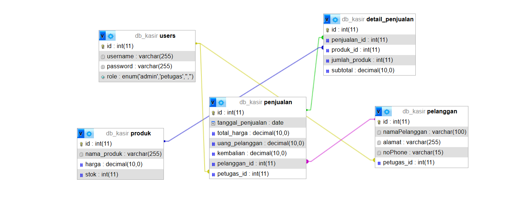

## 4. Alur Aplikasi ##

### 4.1 Halaman awal ###

`frontend/index.php` menampilkan halaman awal WebKasir dan tombol menuju login.

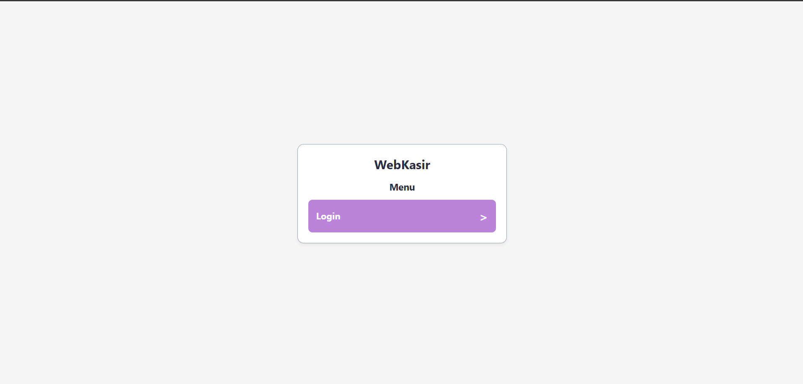

### 4.2 Login ###

### Login
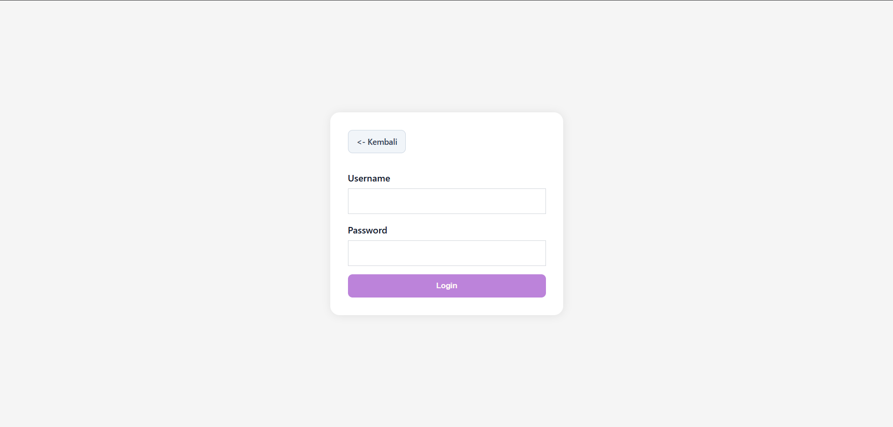

1. Pengguna membuka `frontend/auth/page/login.php`.
2. Form mengirimkan `username` dan `password` menggunakan metode `POST`.
3. Form diarahkan ke `backend/auth/login_controller.php`.
4. Controller mencari akun pada tabel `users`.
5. Jika akun ditemukan, controller menyimpan ID pengguna pada `$_SESSION['id']`.
6. Role `admin` diarahkan ke dashboard admin.
7. Role `petugas` diarahkan ke dashboard petugas.

### Dashboard Admin
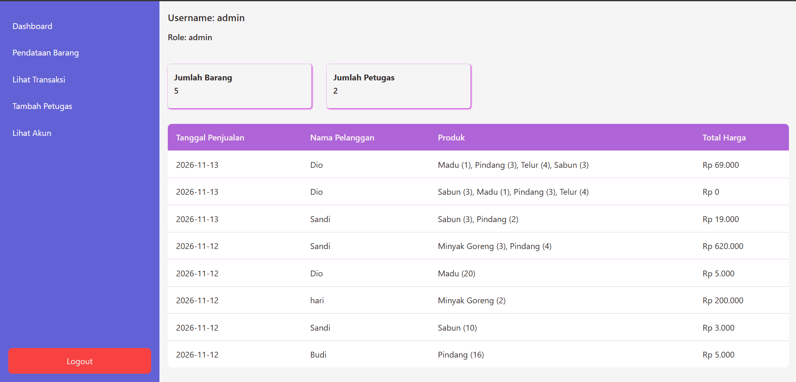

### Dashboard Petugas
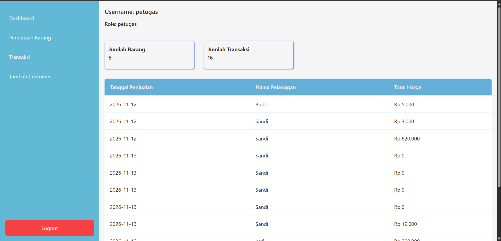

### 4.3 Pemeriksaan session

`backend/auth.php`:

- Memulai session jika belum aktif.
- Memeriksa apakah `$_SESSION['id']` tersedia.
- Mengarahkan pengguna ke halaman login jika belum login.

### 4.4 Pengambilan data pengguna

`backend/getUserData.php`:

1. Memuat koneksi database.
2. Memastikan autentikasi melalui `auth.php`.
3. Mengambil ID pengguna dari session.
4. Menjalankan query ke tabel `users`.
5. Menyimpan hasil ke variabel `$dataUser`.

### 4.5 Logout

`backend/auth/logout.php` memulai session, menghancurkan session melalui `session_destroy()`, lalu mengarahkan pengguna ke halaman login.

## 5. Folder Frontend ##

### 5.1 Halaman umum

| File | Fungsi |
|---|---|
| `fronted/index.php` | Halaman awal dengan tombol login. |
| `frontend/index.css` | Styling halaman awal. |

### 5.3 Komponen bersama

| File | Fungsi |
|---|---|
| `frontend/components/header.php` | Menampilkan username dan role dari `$dataUser.` |
| `frontend/components/sidebar.php` | Menampilkan menu berdasarkan role admin atau petugas serta tombol logout. |

Sidebar menggunakan kondisi role:

- `admin`: Dashboard, Pendataan Barang, Lihat Transaksi, Tambah Petugas, Lihat Akun.
- `petugas`: Dashboard, Pendataan Barang, Transaski, Tambah Pelanggan.

### 5.4 Halaman Admin

### Dashboard Admin


Fungsi: Dashboard admin menampilkan jumlah produk, jumlah petugas, dan daftar penjualan.

### Daftar Produk

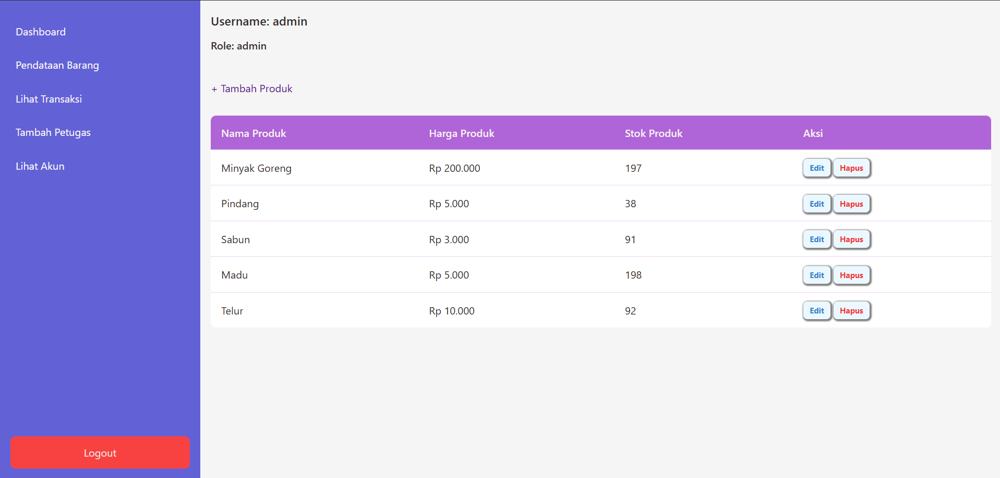

Fungsi: Menampilkan semua data produk serta tombol tambah, edit, dan hapus.

### Tambah Produk

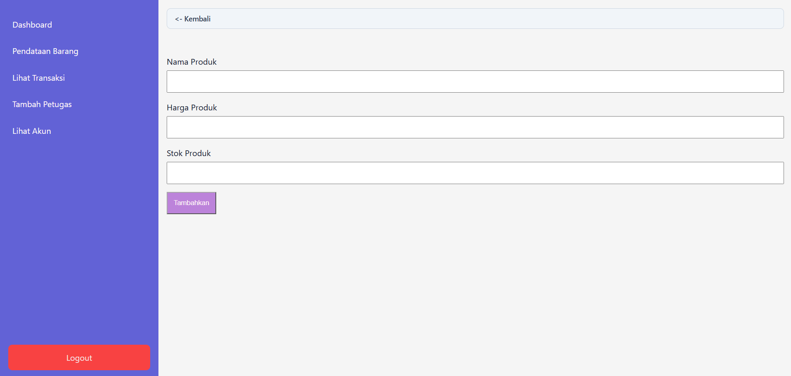

Fungsi: Tambah produk dengan input nama produk, harga produk, dan stok produk.

### Edit Produk

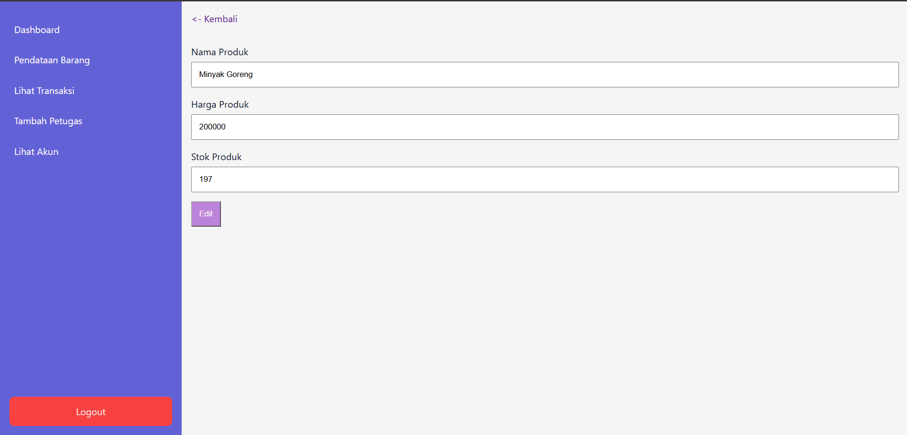

Fungsi: Mengambil produk berdasarkan ID URL dan menampilkan form edit.

### Transaksi

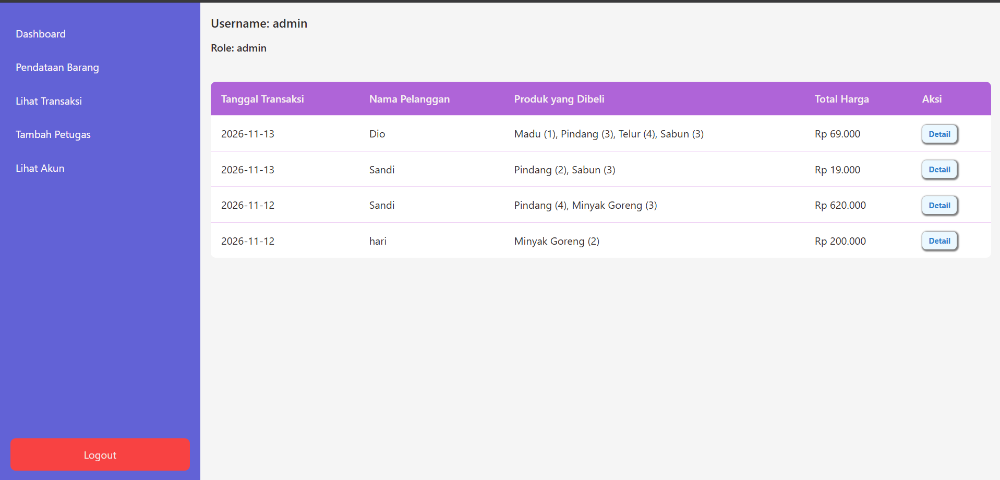

Fungsi: Menampilkan daftar transaksi beserta pelanggan, produk, total, dan tombol edit.

### Detail Transaksi

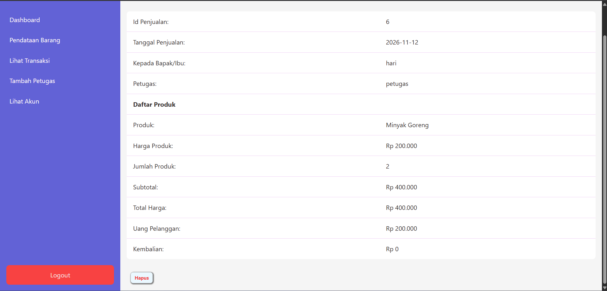

Fungsi: Menampilkan detail transaksi berdasarkan ID penjualan.

### Register Petugas

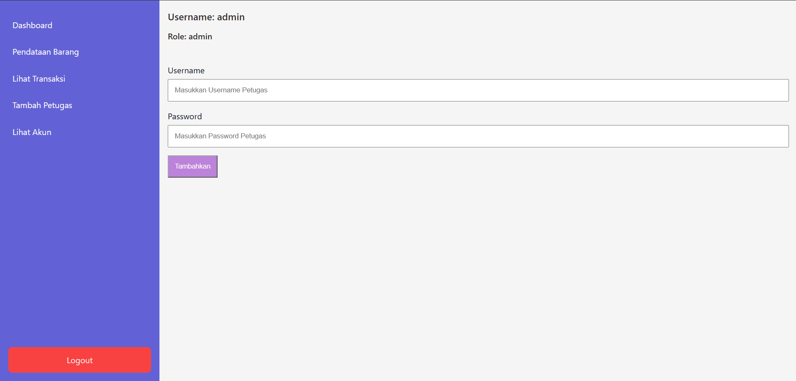

Fungsi: Form pembuatan akun petugas.

### Lihat Akun

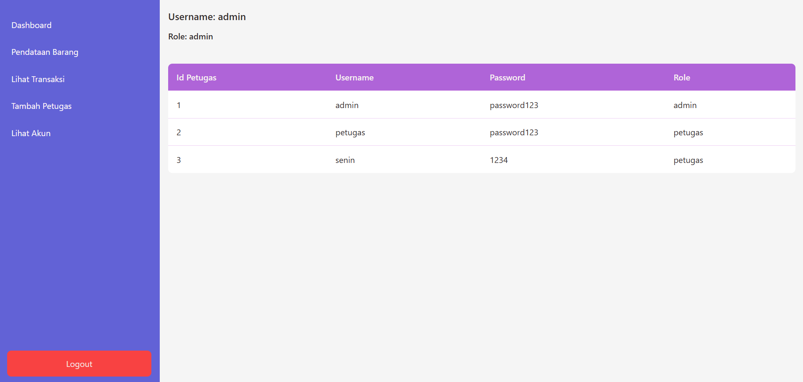

Fungsi: Menampilkan daftar akun pengguna beserta username dan role.

### 5.5 Halaman Petugas

### Dashboard Petugas


Fungsi: Menampilkan ringkasa produk atau transaksi dan daftar penjualan.

### Daftar Produk

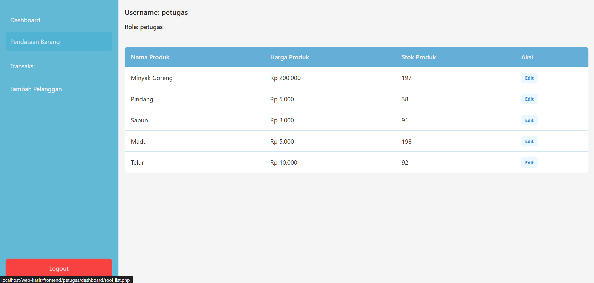

Fungsi: Menampilkan daftar produk dan tombol edit produk.

### Edit Produk

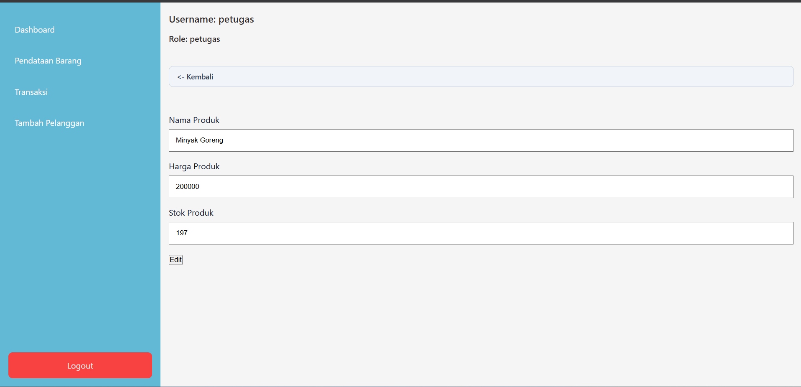

Fungsi: Form edit produk berdasarkan ID.

### Transaksi

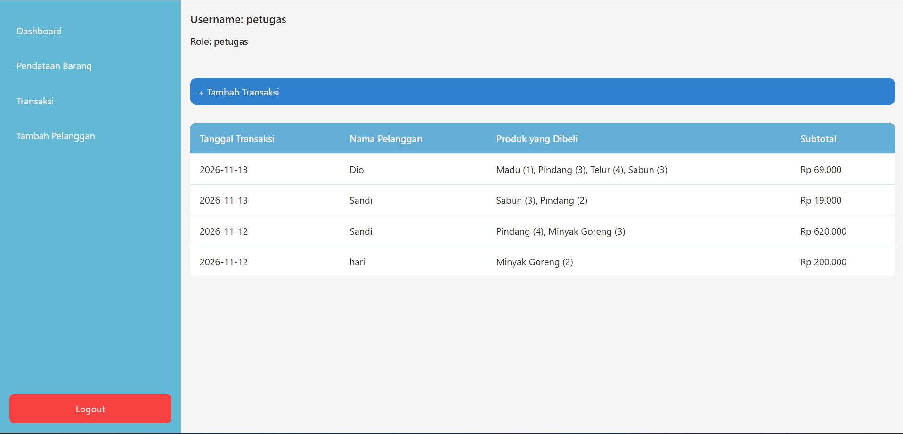

Fungsi: Menampilkan daftar transaksi dan tombol untuk menambah transaksi.

### Tambah Transaksi

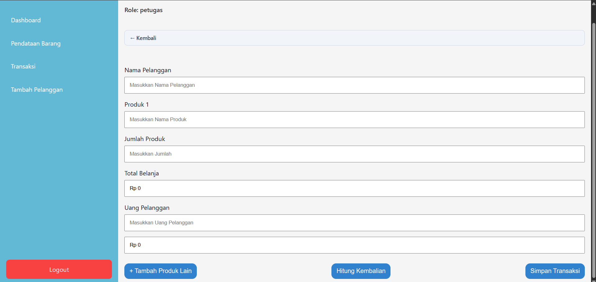

Fungsi: Form transaksi dengan pilihan pelanggan, produk, jumlah produk, uang pelanggan, dan kembalian.

### Tambah Pelanggan

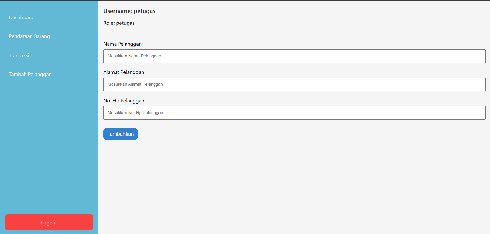

Fungsi: Form menambah pelanggan.

### 5.6 Utilitas tampilan

`frontend/utils/price_format.php` mendefinisikan fungsi:

```php
function Rupiah($number) {
    $rupiah = "Rp " . number_format($number, 0, ',', '.');
    return $rupiah;
}
```

Fungsi `Rupiah()` mengubah angka menjadi format mata uang Rupiah, misalnya `15000` menjadi `Rp 15.000`.

## 6. Folder Backend ##

### 6.1 Autentikasi dan data pengguna

| File | Fungsi |
|---|---|
| `backend/auth.php` | Memulai session dan menolak akses jika session Id tidak tersedia. |
| `backend/auth/login_controller.php` | Memproses login dan mengarahkan pengguna berdasrkan role. |
| `backend/auth/logout.php` | Mengakhiri session dan mengarahkan ke login. |
| `backend/getUserData.php` | Mengambil data akun yang sedang login. |
| `backend/connection.php` | Membuat koneksi MySQL. |

### 6.2 Controller

Controller menerima data dari form atau URL, kemudian menjalankan operasi database.

#### `add_customer_controller.php`

- Meneriman `namaPelanggan`, `alamat`, dan `noPhone` dari POST.
- Mengambil ID petugas aktif dari `$dataUser`.
- Menambahkan data ke tabel `pelanggan`.
- Jika query berhasil, mengarahkan pengguna ke dashboard petugas.

#### `add_transaction_controller.php`

Alur pemrosesan transaksi:

1. Mengambil nama pelanggan, daftar produk, jumlah masing-masing produk, dan uang pelanggan dari POST.
2. Mengambil ID petugas aktif.
3. Mencari ID pelanggan berdasarkan nama pelanggan.
4. Membuat data awal pada tabel `penjualan`.
5. Mengambil ID penjualan yang baru dibuat dengan `mysqli_insert_id()`.
6. Melakukan perulangan pada daftar produk.
7. Mencari ID dan harga produk.
8. Menghitung subtotal berdasarkan harga dikali jumlah.
9. Menambahkan detail ke `detail_penjualan`.
10. Mengurangi stok produk.
11. Menghitung kembalian.
12. Memperbarui total harga, uang pelanggan, dan kembalian pada tabel `penjualan`.
13. Mengarahkan pengguna ke halaman transaksi petugas.

#### `delete_controller.php`

- Menerima ID produk melalui parameter GET `id`.
- Menghapus data dari tabel `produk`.
- Mengarahkan pengguna kembali ke daftar produk berdasarkan role.

#### `delete_detail_controller.php`

- Menerima ID penjualan melalui parameter GET `id`.
- Menghapus data dari tabel `detail_penjualan` berdasarkan ID penjualan.
- Mengahapus data dari tabel `penjualan` berdasarkan ID.

- Jika query berhasil, mengarahkan pengguna ke transaksi petugas.

#### `edit_controller.php`

- Menerima ID, nama produk, harga, dan stok melalui POST.
- Memperbarui data produk berdasarkan ID.
- Mengarahkan pengguna kembali ke daftar produk berdasarkan role.

#### `register_controller.php`

- Memastikan session login melalui `auth.php`.
- Menerima username dan password dari POST.
- Menambahkan pengguna baru dengan role `petugas`.
- Mengarahkan kembali ke dashboard admin.

### 6.3 Query Admin

#### `backend/queries/admin/home_query.php`

Menjalankan query untuk:

- Mengambil seluruh produk dan menghitung jumlah produk.
- Mengambil akun dengan role `petugas` dan menghitung jumlah petugas.
- Mengambil data penjualan, pelanggan, dan detail produk.
- Menggabungkan nama produk beserta jumlahnya menggunakan `group_concat`.
- Mengurutkan penjualan dari ID terbaru.

Variabel hasil yang digunakan `$jumlahProduk`, `$jumlahPetugas`, dan `$queryPenjualan`.

#### `backend/queries/admin/transaction.php`

Mengambil daftar penjualan dengan `join` ke tabel pelanggan, detail penjualan, dan produk. Nama produk dan jumlahnya digabungkan menjadi satu kolom `daftar_produk`. Hasil diurutkan berdasarkan ID penjualan terbaru dan disimpan pada `$query`.

#### `backend/queries/admin/detail_query.php`

Mengambil detail suatu penjualan berdasarkan parameter GET `id`. Query menggabungkan data detail penjualan, penjualan, produk, pelanggan, dan akun petugas.

### 6.4 Query Petugas

#### `backend/queries/petugas/home_query.php`

- Mengambil seluruh produk dan menghitung jumlah produk.
- Mengambil akun petugas.
- Mengambil data penjualan dan pelanggan.
- Mengambil gabungan detail penjualan, produk, dan pelanggan.
- Menghitung jumlah baris hasil `join` sebagai `$jumlahTransaksi`.

Catatan: query ini baris hasil join, sehingga nilai tersebut belum tentu sama dengan jumlah transaksi.

#### `backend/queries/petugas/transaction_query.php`

Mengambil daftar transaksi dengan `join` ke pelanggan, detail penjualan, dan produk. Nama produk beserta jumlahnya digabungkan dengan `group_concat`. Hasil disimpan pada `$query`.

#### `backend/queries/petugas/add_transaction_query.php`

Menyiapkan data untuk halaman form transaksi:

- Mengambil nama dan harga produk.
- Mengambil nama pelanggan.
- Menyimpan daftar produk ke array `$productData`.
- Membaca data form sebelumnya agar input tetap terisi.
- Menghitung total harga dari produk dan kuantitas yang dipilih.
- Menambah jumlah input produk jika tombol `add_input` dikirim.
- Menghitung kembalian jika tombol `hitung_kembalian` dikirim dan uang pelanggan mencukupi.

## 7. Alur Fitur Utama

### 7.1 Menambah produk

```text
Admin membuka add_tool.php
        |
Mengisi nama, harga, dan stok
        |
Form POST ke add_tool_controller.php
        |
INSERT ke tabel produk
        |
Redirect ke daftar produk
```

### 7.2 Menambah pelanggan

```text
Petugas membuka add_customer.php
        |
Mengisi nama, alamat, dan nomor HP
        |
POST ke add_customer_controller.php
        |
Controller mengambil ID petugas dari session
        |
INSERT ke tabel pelanggan
        |
Redirect ke dashboard petugas
```

### 7.3 Membuat transaksi

```text
Petugas membuka add_transaction.php
        |
Query menyiapkan data produk dan pelanggan
        |
Petugas memilih pelanggan, produk, dan jumlah
        |
Query form menghitung total belanja
        |
Petugas memasukkan uang pembayaran
        |
Controller membuat penjualan dan detail penjualan
        |
Stok produk dikurangi
        |
Total dan kembalian disimpan
        |
Redirect ke daftar transaksi
```

### 7.4 Melihat detail transaksi (Admin)

```text
Admin membuka transaction.php
        |
Memilih tautan Detail dengan ID penjualan
        |
detail.php menerima parameter GET id
        |
detail_query.php menjalankan JOIN
        |
Halaman menampilkan data penjualan dan item produk
```

### 8. Styling

### CSS

- `frontend/index.css`: tampilan halaman awal.
- `frontend/auth/css/login.css`: tampilan login.
- `frontend/admin/css/index.css`: tampilan halaman admin.
- `frontend/petugas/css/index.css`: tampilan halaman petugas.

## 9. Cara Menjalankan Project

1. Pastikan XAMPP dengan Apache, PHP, dan MySQL sudah tersedia.
2. Download atau git clone `web-kasir` ke direktori `htdocs`.
3. Jalankan Apache dan MySQL.
4. Buat database dengan nama `db_kasir`.
5. Siapkan tabel dan relasi sesuai dengan foto tabel relasi sebelumnya.
6. Periksa konfigurasi pada `backend/connection.php`.
7. Buka halaman awal melalui browser, misalnya:

   `http://localhost/web-kasir/frontend/index.php`

8. Login menggunakan akun yang sudah tersedia pada tabel `users`.
